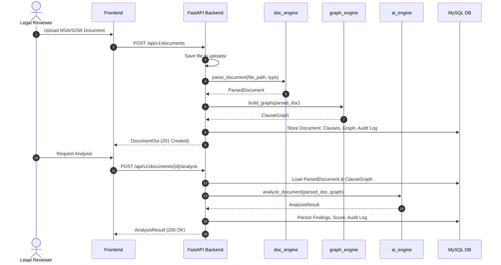
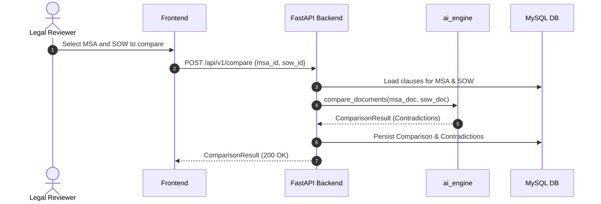

# Architecture & System Design

## 1. Overview
The Contract & SOW Risk Analyzer is built around a single central FastAPI backend application that orchestrates three pure, decoupled functional engines:
- **`doc_engine`**: Extracts structured clauses from PDF/DOCX contracts.
- **`graph_engine`**: Builds directed dependency graphs and evaluates structural clause relationships.
- **`ai_engine`**: Executes playbook rules, detects contradictions, and formulates redlines.

```
                              +-------------------------+
                              |   Frontend (React+Vite) |
                              +-------------------------+
                                           | HTTP / REST (Contract 3)
                                           v
                              +-------------------------+
                              |     FastAPI Backend     |
                              +-------------------------+
                                 |         |         |
                  Contract 1    |         |         | Contract 1 & 2
                  (Parse)       v         |         v (Analyze / Compare)
        +--------------------------+      |      +--------------------------+
        |        doc_engine        |      |      |        ai_engine         |
        | (Pure: PDF/DOCX Parsing) |      |      |  (Playbook, RAG, Rules)  |
        +--------------------------+      |      +--------------------------+
                                          |                    |
                            Contract 1    |                    v
                            (Graph Build) v            +----------------+
                        +--------------------------+   |   ai_engine/   |
                        |       graph_engine       |   |     llm.py     |
                        | (Pure: NetworkX DiGraph) |   +----------------+
                        +--------------------------+           |
                                                               v
                                                      [ LLM Providers ]
                                                    (OpenAI / Gemini / Stub)
```

## 2. Component Boundaries & Isolation Table

| Engine | Inputs | Outputs | Permitted Imports | Strictly Forbidden Imports |
| :--- | :--- | :--- | :--- | :--- |
| **`doc_engine`** | File path (`str`), document type (`str`) | `ParsedDocument` | Standard library, `shared.contracts`, PyMuPDF, python-docx, pytesseract | `backend`, `fastapi`, `pymysql`, `sqlalchemy`, `graph_engine`, `ai_engine` |
| **`graph_engine`** | `ParsedDocument` | `ClauseGraph` | Standard library, `shared.contracts`, `networkx` | `backend`, `fastapi`, `pymysql`, `sqlalchemy`, `doc_engine`, `ai_engine` |
| **`ai_engine`** | `ParsedDocument`, optional `ClauseGraph` | `AnalysisResult`, `ComparisonResult` | Standard library, `shared.contracts`, sentence-transformers, chromadb, `ai_engine.llm` | `backend`, `fastapi`, `pymysql`, `sqlalchemy`, `doc_engine`, `graph_engine` |
| **`backend`** | HTTP requests, File uploads | API JSON Responses (Contract 3) | `shared.contracts`, all 3 engines, `fastapi`, `pymysql`, `passlib`, `jose` | `sqlalchemy` (Raw SQL only), frontend code |

## 3. Core Architectural Invariants
1. **Database Access Exclusivity**: ONLY `backend/` connects to the MySQL database. Engines never touch the database or hold DB connections.
2. **LLM Invocation Exclusivity**: ONLY `ai_engine/llm.py` performs LLM completion calls. No external SDK calls are permitted outside this module.
3. **Data Model Immutability**: All inter-module communication is typed using immutable models from `shared/contracts.py`.

## 4. End-to-End Orchestration Flows

### Analysis Flow (Single Document)


### Comparison Flow (MSA vs SOW)


